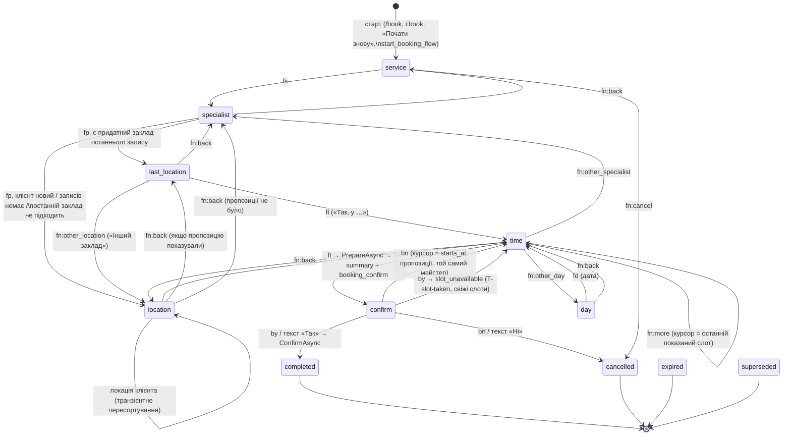

## ADR-020: Детермінований Telegram-запис кнопками без ШІ на кроках

**Date:** 2026-11-07 (ревізія 2026-11-07: локацію клієнта не зберігаємо, початковий крок «останній заклад»)
**Status:** accepted (2026-11-07; рішення користувача — §5). Юридичні пункти ADR-010 §7.3 / ADR-011 §8.3 / ADR-013 §8.4 лишаються **відкритими**: без мерджу в `main` і прод-деплою. Реалізацію у feature-гілці, тести й локальний smoke з тестовим ботом дозволено.
**Author:** project-architect
**Deciders:** рішення продукту §1.3 затвердив користувач 2026-11-07, рішення 5 переглянуто того ж дня (§1.3). Позначка *(можна змінити)* — припущення архітектора: його можна змінити правкою контракту без нового ADR. Решту рішень погоджують на gate.

**Уточнює:**
- **ADR-011** §2.3 (конвеєр), §2.4 (tools `ClientChat`: `prepare_booking` недоступний моделі, коли діє потік; новий `start_booking_flow`), §2.5 (етап 1 запису виконує код потоку, а не модель).
- **ADR-013** §2.2 (нові verb), §2.5 (`slot_pick` з результату `find_slots` моделі за потоку не створюється), §2.6 (`/book`, `i:book` запускають потік), §7 («керований запис кнопками» і «Інший день» переходять з V2 у V1).
- **ADR-014**, частина B / §25.4: reply-кнопка отримує `request_location` поряд із `request_contact`.
- **ADR-017**: Q1 у чаті закривається порядком кроків (майстра обрано до показу ціни).

Рішення цих ADR, не згадані тут, лишаються чинними. Вимкнений потік (`ChatFlow:Enabled=false`) означає поведінку ADR-011/013 без змін.

Контракт: новий розділ `beauty-contracts.md` §28 + позначки **«Зміна»** в §21–§23 і §25.4 (перелік у §8). Задачі: TASK-835…845 (§7).

---

### 1. Context

#### 1.1 Поточна поведінка (перевірено читанням коду 2026-11-07)
- **Запис веде модель.** `ConversationTurnProcessor.RunModelAsync` (крок 8) викликає `BeautyAssistant` зі scope `ClientChat`. Модель сама проходить `list_services` → `list_specialists` → `find_slots` → `prepare_booking`, часто за **один хід**. Тоді клієнт одразу отримує текст моделі й окремим повідомленням T-summary з `booking_confirm` [Так / Ні / Інший час] (§23.6). Клієнт не обирав ні майстра, ні заклад, ні час: їх обрала модель.
- **Вартість.** Кожен хід — кілька ітерацій LLM з tools (облік `chat_llm_usage` у `beauty_ai_actions`), плюс історія до 20 повідомлень. Базову лінію «запитів LLM на один запис» не виміряно: її треба зняти з `chat_llm_usage` до вмикання потоку (TASK-843). Цифр тут свідомо немає.
- **Кнопки вже є, але лише точкові** (ADR-013, TASK-753):
  - `slot_pick` з'являється, якщо модель викликала `find_slots`, але не `prepare_booking`;
  - `sp` → `ChatBookingService.PrepareAsync` без LLM;
  - `booking_confirm` (`by|bn|bo`); `bo` = `DeclineAsync` + T-other-time («напишіть, коли зручно»), тобто знову хід LLM.
- **`/book`, `i:book`** → T-book-start («напишіть, яку послугу…»), далі хід LLM.
- **Транспорт кнопок готовий:**
  - `beauty_chat_keyboards`: токен 22 символи, `options jsonb` ≤ 10, CAS `active → used`, TTL, відкликання, прибирання розмітки, sweeper;
  - `CallbackAddress`: `^(by|bn|bo|sp|rc|ac|aa|ar|cy|cn|mc|co):{token22}(:[0-9])?$`, ≤ 28 байт;
  - reply-клавіатура з `request_contact` (§25.4) і стан `reply_keyboard_open_at`.
- **Каталог.** `IPublicBookingStore.ListServicesAsync(locationId, specialistId?)` і `ListSpecialistsAsync(locationId, serviceId?)` уже фільтрують у межах закладу за майстром і послугою. Придатний майстер: активний, зв'язок із закладом активний, є робочі години, є активна послуга. Запитів у межах усього tenant («послуги, для яких є придатний майстер хоч у якомусь закладі», «майстри, що виконують послугу», «заклади, де цей майстер виконує цю послугу») немає. Їх додає `IChatFlowCatalog` (§2.2) на тих самих правилах придатності.
- **Історія записів.** `beauty_appointments.location_id` / `client_id` є. Клієнт чату створюється ліниво при першому підтвердженому записі (ADR-011 §2.5), тож `conversation.client_id IS NULL` означає «записів з чату ще не було».
- **Профіль Telegram** вже передається від ingest до конвеєра лише через пам'ять процесу (`ConversationSignals.SenderName`). Після рестарту ім'я втрачається, і це прийнято (§21.10 smoke). Цей самий механізм потік використовує для транзієнтних координат (§2.7).
- **Геодані.** `beauty_locations` не має координат. Telegram `message.location` парсер кладе в `MediaKeys` → `kind=unsupported`, тіло `[location]`, координати не зберігаються.
- **ADR-017** (ціна/тривалість майстра) — `proposed`, TASK-804…814 `planned`. Зараз ціна = заклад, інакше мережа; тривалість — послуги.

#### 1.2 Проблема
1. Клієнт не бачить вибору: модель «вгадує» майстра, заклад і час, а тоді одразу показує підсумок.
2. Токени витрачаються на кроки, відповідь на які однозначно визначає БД (перелік закладів, послуг, майстрів, слотів).
3. Відповіді моделі про послуги й слоти не є детермінованими. Guard-и (ADR-011 §2.8, PolicyClaimGuard) лише зменшують ризик вигадок.

#### 1.3 Рішення продукту (затверджено користувачем 2026-11-07)
1. Кроки: **послуга** (кнопки з назвами, без нумерованого тексту) → **спеціаліст**, що виконує послугу → **заклад**, де цей спеціаліст виконує цю послугу (на початку кроку — «Так, у «{останній заклад}»» / «Інший заклад») → **день/час** → **підтвердження** (Так / Ні / Інший час). Готовий підсумок одразу не видається. Крок з однозначним вибором (єдиний спеціаліст, єдиний заклад) пропускається з коротким «Обрано: …». Послуга не пропускається ніколи. *Порядок підтвердив користувач (Q6, 2026-11-07).*
2. Кроки формуються з БД без LLM. Claude потрібен лише для вільного тексту й питань і відповідає лише з наявних даних (заклади, послуги, майстри, слоти), нічого не вигадуючи. Метрика: **0 викликів LLM на кнопкових кроках**.
3. Геолокація: кнопка Telegram «Поділитись локацією» (`request_location`) — **додаткова** опція лише для сортування списку закладів, найближчий іде першим. У закладу з'являється необов'язкове поле координат (міграція, RLS). Без координат або при відмові клієнта показується звичайний список.
4. «Інший час» показує наступні слоти того самого спеціаліста (детермінована пагінація). Якщо слотів немає — кнопки «Інший день» / «Інший спеціаліст».
5. **Ревізія.** Локацію клієнта **не зберігаємо** в жодній формі: ні таблиці підказок, ні округлених координат, ні строку зберігання, ні `/forget` для цього. Координати обробляються транзієнтно, лише для сортування, і не пишуться в БД і логи. Натомість на початку кроку закладу **кожного нового запису** бот першим пропонує **заклад останнього запису** клієнта з історії `beauty_appointments`: [Так, у «…»] / [Інший заклад]. Новий клієнт або клієнт без записів одразу бачить список закладів.
6. Стан потоку — автомат поверх `ConversationTurnProcessor`, з таймаутом скидання.
7. Послуги фільтруються за спеціалістом, а спеціалісти — за послугою (буде другий співробітник з додатковими послугами).

---

### 2. Decision

#### 2.0 Коротко
Новий **автомат запису** `BookingFlow` живе в БД (`beauty_chat_booking_flows`, одна активна на розмову) і рухається **лише кодом**:
- натисканнями нових станових кнопок `f*`;
- точним текстовим збігом із підписом кнопки поточного кроку;
- повідомленням-локацією (лише сортування).

Перший крок — послуга. Крок закладу (після спеціаліста) починається з пропозиції закладу останнього запису, якщо такий підходить, інакше зі списку закладів. Кожен крок — системне повідомлення з клавіатурою, побудованою з БД. Обробник потоку не має залежності від `BeautyAssistant`, тож «0 LLM на кнопкових кроках» гарантує побудова, а не дисципліна. LLM лишається для вільного тексту. Вона бачить стан потоку як дані й може лише **запустити або перезапустити** потік (`start_booking_flow` з префілом id із результатів tools). Підсумок і запис створює тільки код. Координати клієнта живуть лише в пам'яті процесу між ingest і ходом. Потік діє, коли `ChatFlow:Enabled=true` і кнопки доступні для розмови (`ButtonsAvailable`). Інакше працює шлях ADR-011 без змін.

#### 2.1 Автомат станів

Правила, які діаграма не показує:
- **Заклад останнього запису** — `location_id` найпізнішого за `starts_at` нескасованого запису `conversation.client_id` (статус `pending|confirmed|completed`; майбутній запис теж рахується; Q6в вирішено). Обчислюється на старті потоку. Пропозиція `last_location` показується, лише якщо цей заклад входить в опції кроку закладу, тобто обраний спеціаліст виконує в ньому обрану послугу (§2.2). Інакше крок закладу починається зі списку `location`. Клієнта в розмові немає → `location`. Це наявні дані, нових ПД потік не створює. Клієнт бачить лише власну історію у своєму чаті.
- **Коли показується.** На початку кроку закладу **кожного** нового запису (Q6б вирішено). Префіл `locationId` від LLM (валідний для послуги й майстра) пропускає обидва кроки закладу.
- **Автопропуск.** Після кожного переходу код обчислює опції наступного кроку. Рівно одна опція → вибір фіксується автоматично, крок позначається `skipped`, у повідомлення наступного кроку додається рядок «Обрано: спеціаліст Олена» / «Обрано: заклад «Центр», вул. …».
  - Пропускаються лише `specialist` і крок закладу (`last_location` + `location`). **Послуга не пропускається ніколи**, навіть з однією опцією.
  - Єдиний заклад, де обраний спеціаліст виконує послугу, → крок закладу пропущено без пропозиції `last_location`. Канал з `beauty_channels.location_id` фіксує заклад на старті: послуги й майстри фільтруються цим закладом, крок закладу пропускається *(можна змінити)*.
  - Пропуск ланцюжковий (спеціаліст і заклад можуть пропуститися разом). `fn:back` перескакує через пропущені кроки до останнього, де клієнт реально обирав.
- **Нуль опцій.**
  - `service` на старті: немає послуг для запису → T-flow-no-services + [👤 Адміністратор], потік `cancelled`;
  - `specialist`/заклад: опції зникли між кроками (гонка, деактивація) → повернення на попередній крок зі свіжими даними й рядком «Цей варіант уже недоступний»;
  - `time`: у вікні сканування слотів немає → T-flow-no-slots + [Інший день] [Інший спеціаліст] (лише якщо майстрів > 1) [⬅ Назад].
- **Префіл від LLM.** Послуга (валідна) → старт з `specialist`. Майстер без послуги → крок `service` з послугами цього майстра. Заклад без майстра → послуги й майстри фільтруються закладом. Префіл, що не узгоджується з уже обраним (майстер не виконує послугу, заклад не має пари «майстер + послуга»), тихо відкидається.
- **Інваріант «не одразу підсумок».** У `confirm` можна потрапити **лише** з `time` вибором конкретного слота: кнопкою `ft` або точним текстом підпису слота. Навіть повний префіл від LLM (послуга, майстер, заклад, бажаний час) доводить потік щонайбільше до `time`, де слоти близько бажаного часу стоять першими.
- **Одна активна** на розмову. Новий старт переводить попередню в `superseded`, її клавіатури `revoked`.
- **Таймаут скидання — 30 хв бездіяльності** (`ChatFlow:IdleTimeoutMinutes`, 5..240): `expires_at = now + 30 хв` оновлюється на кожному переході. Після закінчення потік стає `expired` (ліниво при наступній взаємодії або sweeper-ом), клавіатури `expired` і прибираються. Проактивного повідомлення немає (без спаму). Натискання після таймауту → T-flow-expired + [📅 Почати знову]. У кроці `confirm` додатково діє TTL пропозиції (15 хв, ADR-011): він коротший, тож чинний.
- **Handoff.** Вхід у handoff (будь-який тригер) переводить активний потік у `cancelled` (`cancel_reason=handoff`) і відкликає його клавіатури (розширення §23.6 «Відкликання»). Під час handoff verb `f*` → `handoff_blocked`, як `sp/by`.
- **Режим `suggest`:** потік недоступний. `/book` / `i:book` у suggest поводяться як зараз (Q1).

#### 2.2 Опції кроків (джерело — БД, без LLM)
Усі запити йдуть під RLS tenant каналу через порт `IChatFlowCatalog` (Application). Придатність майстра та сама, що в публічному каталозі (`EligibleSpecialistIdsAsync`), але узагальнена на всі активні заклади tenant. Слоти — наявний `OnlineBookingCore.GetSlotsAsync`. Нові запити: `ListBookableServicesAsync(specialistId?, locationId?)`, `ListSpecialistsForServiceAsync(serviceId, locationId?)`, `ListLocationsForAsync(serviceId, specialistId)` і `GetLastAppointmentLocationAsync(clientId)`.

| Крок | Опції | Порядок | Розмір сторінки |
|---|---|---|---|
| `service` | активні послуги, які виконує ≥ 1 придатний майстер у ≥ 1 активному закладі, де для послуги є ціна. Якщо майстра вже визначено (префіл) — лише його послуги (рішення 7) | категорія, назва | `ChatFlow:PageSize` = 5 |
| `specialist` | придатні майстри з призначенням на обрану послугу хоча б в одному активному закладі, де є ціна (рішення 7) | ім'я | 5 |
| `last_location` | [✅ Так, у «{заклад}»] + [Інший заклад], якщо заклад останнього запису є серед опцій `location` | — | 2 кнопки |
| `location` | активні заклади, де обраний майстер придатний і виконує обрану послугу, і для послуги є ціна | відстань (лише якщо клієнт щойно поділився локацією, §2.7), інакше назва | 5 |
| `time` | слоти `OnlineBookingCore.GetSlotsAsync(location, specialist, service, date)` з `startsAt > cursor` | `startsAt` | `ChatButtons:SlotButtons` = 6 |
| `day` | дати від сьогодні до `MaxDaysAhead`, де є ≥ 1 слот | дата | `ChatFlow:DayPageSize` = 6 |

- **Пагінація курсорна, не offset-на.**
  - `time`: курсор = `startsAt` останнього показаного слота;
  - `day`: курсор = остання показана дата;
  - списки: стабільний ключ сортування останнього показаного елемента.
  
  Курсор зберігається в рядку потоку. Нові записи інших клієнтів не дають дублів чи пропусків, а повтор того самого натискання дає той самий результат. Відсортований за відстанню список також пагінується курсором, але порядок живе лише в межах ходу (§2.7). На «Ще» без координат список повертається до порядку за назвою з рядком «Сортування за відстанню скинуто» *(можна змінити)*.
- **Обмеження навантаження.** Один крок `time`/`day` сканує не більше `ChatFlow:MaxScanDays` = 14 днів (≤ `MaxDaysAhead`). Нічого не знайдено → «Інший день» показує подальші дні.
- **«Ще» на останній сторінці** списку стає «↩ На початок» *(можна змінити)*.
- **Ціни на кнопках у V1 не показуються.** Ціна є в T-summary, її рахує `PrepareAsync`. Після ADR-017 (TASK-806) підпис майстра може отримати ціну майстра (Q2).
- **«Будь-який спеціаліст» у V1 немає**: рішення продукту 1 вимагає обрати спеціаліста. Q3.

#### 2.3 Callback-формати й валідація
- **Нові станові verb** (закритий перелік, index обов'язковий): `^(fs|fp|fl|fd|ft|fn):[A-Za-z0-9_-]{22}:[0-9]$`. Довжина 27 байт ≤ 28 (ліміт `CallbackAddress`) ≤ 64 (Telegram). Regex розширюється в `TelegramAdapter`, `CallbackAddress` і `ButtonVerbs`; безстанові `i:*` не змінюються.

| Verb | Kind клавіатури | Споживає | Дія |
|---|---|---|---|
| `fs` | `flow_service` | так | обрати послугу → `specialist` (автопропуск) |
| `fp` | `flow_specialist` | так | обрати спеціаліста → `last_location` / `location` (автопропуск) |
| `fl` | `flow_last_location`, `flow_location` | так | обрати заклад → `time` |
| `fd` | `flow_day` | так | обрати дату → `time` (курсор = початок дня) |
| `ft` | `flow_time` | так | `ChatBookingService.PrepareAsync` для слота → `confirm` |
| `fn` | будь-який `flow_*` | так | навігація: `options[i].nav ∈ other_location\|more\|back\|other_day\|other_specialist\|cancel` |
| `by/bn/bo` | `booking_confirm` | так | як §23.7; `bo` для пропозиції з `flow_id` — §2.6 (повернення до `time` з курсором), інакше як зараз |

- **`options`** (пише й читає лише код; клієнт і модель їх не бачать): `{verb, label, serviceId? | specialistId? | locationId? | date? | startsAt? | nav?}`. Разом не більше 10 елементів (index 0..9).
- **Розкладка** (обмеження §23.8: ≤ 10 кнопок, ≤ 6 рядків, ≤ 3 у рядку, підпис ≤ 32 кодові точки, санітизація назв з БД):
  - `last_location` — [✅ Так, у «{назва, обрізана}»] / [Інший заклад];
  - списки — по одному елементу в рядку (≤ 5) + рядок навігації [Ще ➡] [⬅ Назад] [✖ Скасувати];
  - `time` — 6 слотів по 3 у рядку («14:30» сьогодні / «пт 14:30»), далі [Ще час ➡] [Інший день] / [Інший спеціаліст] [⬅ Назад] (кнопки без сенсу не показуються; «Скасувати» — якщо лишилося місце);
  - `day` — 6 дат «пт 31.10» по 3 + [Ще дні] [⬅ Назад] [✖].
- **Порядок перевірок** — §23.5 п. 1–7 без змін, далі нові п. 8a–8d, потім §23.5 п. 8–10:
  - **8a.** `keyboard.flow_id` = id активного потоку розмови → інакше `flow_not_active`;
  - **8b.** `keyboard.flow_version` = `flow.version` і `kind` відповідає `flow.step` → інакше `stale_step`;
  - **8c.** `now < flow.expires_at` → інакше `flow_expired` (потік → `expired`);
  - **8d.** повторна перевірка сутності опції під RLS у момент натискання: послуга активна й має придатного майстра, майстер придатний для послуги хоча б в одному закладі, заклад активний і майстер виконує в ньому послугу; для `ft` слот перевіряє `PrepareAsync` (`slot_not_offered`). Невдача → `option_unavailable`;
  - **п. 10 (CAS)** розширюється: в одній транзакції CAS клавіатури `active → used` **і** CAS потоку `UPDATE beauty_chat_booking_flows SET …, version = version + 1, expires_at = now() + idle WHERE id = @id AND version = @v AND status = 'active'`. 0 рядків → `stale_step`, переможець один.
- **Одна активна flow-клавіатура на розмову.** Усі `flow_*` разом входять у `ReplacesPrevious`: нова відкликає попередню будь-якого `flow_*`. Натискання старого повідомлення → `revoked` / `stale_step` → T-action-stale. Повернутися назад можна лише кнопкою «Назад», тож стан однозначний.
- **Результат → відповідь** (доповнення таблиці §23.5):
  - `flow_not_active`, `stale_step` → T-action-stale (раз на 10 хв);
  - `flow_expired` → T-flow-expired + [📅 Почати знову] (`i:book`);
  - `option_unavailable` → рядок «Цей варіант уже недоступний» + поточний крок зі свіжими даними (нова версія);
  - `handoff_blocked` → T-action-handoff (як зараз).
- **Текстовий вибір без LLM** *(можна змінити)*. Текст клієнта, нормалізований (NFKC, lowercase, trim, без емодзі й маркерів, стиснуті пробіли), **точно** збігся з підписом рівно однієї кнопки активної flow-клавіатури → обробка як натискання цієї опції (ті самі перевірки 8a–8d і CAS, `via=text`). На кроці `last_location` збігом також вважаються «так» і «інший» (детермінований перелік). Збіг із кількома або жодною → вільний текст (§2.5). Нумерованих відповідей немає (рішення 1).

#### 2.4 Зберігання стану
**`beauty_chat_booking_flows`** (нова таблиця; RLS ENABLE+FORCE `tenant_isolation`, композитні FK):
- `id`, `tenant_id`, AK `(tenant_id, id)`, `conversation_id` (FK RESTRICT);
- `status varchar(16)`: CHECK ∈ `active|completed|cancelled|expired|superseded`;
- `step varchar(16)`: CHECK ∈ `last_location|location|service|specialist|day|time|confirm`;
- `version int NOT NULL DEFAULT 0` (CAS);
- `location_id`, `service_id`, `specialist_id` NULL (FK на каталог), `day date NULL` (локальна дата закладу), `cursor_at timestamptz NULL` (`time`), `list_cursor varchar(64) NULL` (сторінки списків/днів), `skipped_steps varchar(16)[] NOT NULL DEFAULT '{}'`, `suggested_last_location_id uuid NULL` (FK; заклад останнього запису, обчислений на старті; без координат; потрібен для `last_location` і «Назад»);
- `proposal_id NULL` (FK `beauty_chat_booking_proposals`);
- `origin varchar(16)`: CHECK ∈ `button|command|llm|text`; `cancel_reason varchar(32) NULL`;
- `created_at`, `updated_at`, `expires_at NOT NULL`, `finished_at NULL`;
- частковий UNIQUE `(tenant_id, conversation_id) WHERE status='active'`; індекс `(tenant_id, expires_at) WHERE status='active'` для sweeper;
- **координат і відстаней у таблиці немає** (§2.7);
- **retention:** завершені потоки старші за 30 днів видаляє sweeper *(можна змінити)*. ПД у рядку немає, окрім зв'язку з розмовою.

**Зміни наявних таблиць (адитивно):**
- `beauty_chat_keyboards`: CHECK `kind` + `flow_last_location|flow_location|flow_service|flow_specialist|flow_day|flow_time` (надмножина; `varchar(24)` вміщує); `flow_id uuid NULL` (композитний FK; поведінка видалення узгоджується з retention, напр. PG16 `ON DELETE SET NULL (flow_id)` — рішення `database-engineer`); `flow_version int NULL`; CHECK `kind LIKE 'flow\_%'` ⇔ `flow_id IS NOT NULL AND flow_version IS NOT NULL`.
- `beauty_chat_booking_proposals`: `flow_id uuid NULL` (FK).
- `beauty_messages`: CHECK `kind` + `location` (тіло `[локація]`). **Колонок для координат немає.**
- `beauty_locations`: `latitude numeric(9,6) NULL`, `longitude numeric(9,6) NULL`; CHECK обидва або жодного, `latitude BETWEEN -90 AND 90`, `longitude BETWEEN -180 AND 180`. Це дані бізнесу, не ПД. Віддаються лише staff API (`LocationDto`); публічний DTO не змінюється *(можна змінити)*.
- Індекс для «заклад останнього запису»: наявних індексів `beauty_appointments` за `(tenant_id, client_id, …)` має вистачити. `database-engineer` перевіряє план запиту (skill `create-indexes`) і додає індекс, лише якщо він потрібен.
- `DO`-блок перевіряє FORCE на новій таблиці і на `beauty_chat_keyboards`, `beauty_messages`, `beauty_locations`. GRANT (runbook): API-роль SELECT/INSERT/UPDATE/DELETE на `beauty_chat_booking_flows`. Воркеру нових прав не треба. `worker/src/testing/schema.sql` синхронізувати (schema-drift).
- **Down:** нові `kind` → `unsupported` / клавіатури `revoked`, колонки й таблиця видаляються. Координати закладів втрачаються: на staging/prod це human gate, перед відкатом робиться експорт координат закладів (runbook).

**Чому окрема таблиця, а не колонки `beauty_conversations` (як `pending_prompt`):** полів багато, потрібен CAS за версією, історія завершених потоків для воронки, а `pending_prompt` (нагадування, телефон) живе паралельно й не повинен конфліктувати.

#### 2.5 Межі LLM ↔ БД
| Подія | Хто обробляє | LLM |
|---|---|---|
| Натискання `f*`, `by/bn/bo`, `i:book`, `/book`, «Почати знову» | `ChatBookingFlowService` (код) | **0** |
| Текст = підпис кнопки поточного кроку (§2.3) | код | **0** |
| Повідомлення-локація | код (§2.7) | **0** |
| Текст «Так» / «Ні» на T-summary | крок 5 ADR-011 (без змін) | **0** |
| Інший вільний текст / питання | `BeautyAssistant` (крок 8) | так |

- **Архітектурна гарантія метрики.**
  - `ChatBookingFlowService` і `ConversationTurnProcessor.Flow.cs` не мають залежності від `BeautyAssistant` / `IAiClient`; DI-тест падає, якщо вона з'явиться;
  - обробник callback не викликає крок 8;
  - тест повного кнопкового потоку `/book → … → by` перевіряє 0 викликів mock-LLM і 0 записів `chat_llm_usage`.
- **Вільний текст під час активного потоку.**
  - Модель отримує блок **«СТАН ЗАПИСУ»** (будує код; дані, а не інструкції; назви з БД санітизуються як для кнопок, обгорнуто `WrapToolResult`): крок, обрані послуга / спеціаліст / заклад / день, і лише назви, без id;
  - координат і відстаней у блоці немає ніколи;
  - tools: наявні read-only (`list_locations`, `list_services`, `list_specialists`, `find_slots`, `get_active_promotions`), `request_handoff` і новий `start_booking_flow`;
  - після відповіді моделі код окремим системним повідомленням повторно надсилає поточний крок з новою клавіатурою (версія +1, стара `revoked`): «Продовжимо: оберіть …» (`ChatFlow:ResendStepAfterLlm=true`, *можна змінити*, Q4). Кнопки ніколи не стоять під текстом моделі (принцип ADR-013 §2.3).
- **`start_booking_flow`** (новий tool `ClientChat`): `{serviceId?, specialistId?, locationId?, date?, preferredTime?}`.
  - Кожен id код перевіряє під RLS і на придатність (як 8d). Невалідний id тихо відкидається, крок лишається невирішеним;
  - потік стартує (попередній → `superseded`) на першому невирішеному кроці з автопропуском і не йде далі за `time`;
  - без префілу перший крок — `service`; без `locationId` крок закладу починається з `last_location`/`location` після спеціаліста (§2.1);
  - результат моделі: `{status:"flow_started", step}`, без id і токенів;
  - повідомлення кроку надсилає код окремо після тексту моделі.
- **`prepare_booking` поза scope моделі**, коли потік доступний для розмови (`ChatFlow:Enabled` і `ButtonsAvailable`). Виклик → `tool_not_allowed_in_client_scope`. Для каналів без кнопок і при вимкненому потоці лишається шлях ADR-011 (`prepare_booking` + текстове «Так»). `ChatFlow:LlmPrepareWhenFlow=false` — аварійний перемикач для відкату. За потоку `slot_pick` з результату `find_slots` моделі не створюється (§23.6 «Слоти» діє лише без потоку).
- **«Лише з наявних даних».** Ядро `ChatRules` доповнюється правилами:
  - «Називай лише послуги, спеціалістів, заклади, ціни й час, які є в результатах tools або в блоці СТАН ЗАПИСУ; якщо даних немає — скажи, що не знаєш, і запропонуй адміністратора»;
  - «Щоб записати клієнта, виклич start_booking_flow; не перелічуй слоти текстом як варіанти для запису — їх покаже система кнопками».
  
  Вихідні guard-и ADR-011/§22.9 не змінюються. Перевірка відповідності «час у тексті ↔ слоти» — поза V1.
- **Супершід пропозиції текстом** (правило ADR-011 §2.5) зберігається: інший текст на T-summary → пропозиція `superseded`, потік повертається в `time` (курсор не змінюється), а після відповіді моделі код повторно надсилає крок `time`.

#### 2.6 «Інший час», «Інший день», «Інший спеціаліст»
- **`bo` на підсумку потоку:**
  1. пропозиція `rejected` (як зараз);
  2. потік → `time`, `cursor_at = proposal.starts_at`, той самий майстер і заклад;
  3. показуються наступні `SlotButtons` слотів з `startsAt > cursor_at` у межах `MaxScanDays`, з переходом через дні.
- **`fn:more`** на `time` — те саме від останнього показаного слота.
- **Слотів немає** → T-flow-no-slots «У {спеціаліст} більше немає вільного часу найближчими днями» + [Інший день] [Інший спеціаліст] (лише якщо для послуги > 1 придатного майстра) [⬅ Назад].
- **`fn:other_day`** → `day`: дати з ≥ 1 слотом, починаючи з завтра відносно `cursor_at`, якщо його задано, інакше від сьогодні. `fd` → `time` з `cursor_at` = початок обраного дня (локальний час закладу).
- **`fn:other_specialist`** → `specialist` для тієї самої послуги. Заклад і курсор скидаються, бо інший майстер може працювати в іншому закладі; далі знову крок закладу (з `last_location`, якщо підходить).
- **`slot_unavailable` на `by`** (слот зайняли між підсумком і «Так») → T-slot-taken + `time` зі свіжими слотами від `now`.

#### 2.7 Геолокація (транзієнтно, без збереження)
- **Коли пропонуємо.** Лише на кроці `location`: ≥ 2 опції, `ChatFlow:GeoEnabled=true`, хоча б один заклад-опція має координати, адаптер підтримує reply-клавіатуру, і не відкрите питання про телефон (`pending_prompt≠phone_request`, одна reply-клавіатура за раз). На `last_location` не пропонуємо.
- **Як.** Telegram не дозволяє inline- і reply-клавіатуру на одному повідомленні, тож у транзакції кроку два повідомлення:
  1. T-flow-location з inline-списком `flow_location` (вибір працює одразу);
  2. коротке T-flow-geo-offer з reply-клавіатурою [📍 Поділитись локацією] (`request_location: true`) / [Обрати зі списку], `one_time`, `resize`. Текст: «Можете поділитися локацією, щоб я показав найближчі заклади. Локацію використаю лише зараз для сортування й не зберігаю.»
  
  `ChatReplyButton` адитивно отримує `RequestLocation` (взаємовиключно з `RequestContact`); JSON у `actions` — `{"label":…, "requestLocation":true}`. Стан `reply_keyboard_open_at` і прибирання — як §25.5.1. Канали без reply-клавіатур отримують лише список.
- **Парсер `message.location`** (наявні фільтри: приватний чат, не бот):
  - зберігається лише рядок `kind=location`, `body="[локація]"`, **без координат**;
  - координати, округлені до 4 знаків (≈ 11 м), передаються в пам'яті процесу через `ConversationSignals` (як `SenderName`): ключ `(conversationId, inboundMessageId)`, TTL `ChatFlow:TransientLocationTtlSeconds` = 300, читання видаляє запис;
  - `live_period` ігнорується: береться перша точка, `edited_message` і так не обробляються;
  - **переслане** повідомлення (`forward_origin` / `forward_from` / `forward_date`) → `unsupported`, координати відкидаються: це не позиція клієнта;
  - координати поза діапазоном → `unsupported`;
  - `venue` приймається за його `location` *(можна змінити)*;
  - дедуплікація як для `message`.
- **Обробка (код, 0 LLM).**
  - Потік у кроці `location` і координати є в пам'яті: відстань (haversine, чиста функція в Application; закладів у tenant одиниці-десятки) → список пересортовано, найближчий перший, підпис «Центр · 1,2 км» (округлення до 0,1 км). Нове повідомлення з `flow_location` (версія +1) + `removeReply`. Заклади без координат ідуть після закладів з координатами, за назвою. Координати після сортування відкидаються. У рядку потоку відсортований порядок не зберігається: у `options` клавіатури лишаються лише id закладів і підписи;
  - координат у пам'яті немає (рестарт, інший інстанс, хід узяв recovery-sweeper, TTL минув) → T-location-retry «Не вдалося використати локацію — оберіть заклад зі списку» + список без змін. Прийнятий компроміс;
  - локація поза кроком `location` → координати відкидаються, коротке T-location-unused («Дякую! Щоб записатися — /book»);
  - відмова («Обрати зі списку» або просто натиснутий заклад) → список без змін, reply-клавіатура прибирається;
  - в історію LLM `kind=location` не потрапляє, координат модель не бачить ніколи.
- **Не пишуться нікуди:** ні в БД (`beauty_messages`, потоки, клавіатури, журнал `beauty_ai_actions`, `last_error`), ні в логи (жодних координат, відстаней, назви найближчого закладу), ні в API, ні в LLM. Відповідь T-flow-location з підписами відстаней зберігається як `body` вихідного повідомлення. Щоб відстань із підпису не дала змоги відновити позицію, у `body` і в `actions`, які зберігаються для повторної відправки, підписи **без відстані**. Відстань є лише в тексті, надісланому inline, а при повторі через outbox іде версія без відстаней *(можна змінити — варіант: відстань лише в порядку, без чисел)*. Остаточне правило — у §28 (TASK-835) і security review (TASK-844).

#### 2.8 Персональні дані
- **Нові ПД не зберігаються.** Заклад останнього запису виводиться з наявних `beauty_appointments`. Координати клієнта обробляються транзієнтно в пам'яті процесу (§2.7) з TTL 5 хв і використовуються лише для сортування в поточному ході.
- **Повідомлення клієнту** — у T-flow-geo-offer (§2.7): мета й факт незбереження. Окремої згоди й строку зберігання немає, бо зберігання немає. Текст погоджується в межах загального юридичного gate ADR-010 §7.3 (відкритий, §9 п. 4). Окремим блокером він не є.
- **Що потребує нового ADR:** будь-яке збереження локації клієнта (сирої, округленої чи похідної на кшталт «найближчий заклад»).

#### 2.9 Конфігурація (нові ключі `ChatFlow:*`)
| Ключ | За замовч. | Призначення |
|---|---|---|
| `Enabled` | `false` | Глобальний вимикач. Діє лише разом з `ChatAssistant:Enabled` і `ChatButtons:Enabled`. `false` → поведінка ADR-011/013 |
| `OfferLastLocation` | `true` | Пропозиція `last_location` на початку кроку закладу |
| `IdleTimeoutMinutes` | `30` (5..240) | Таймаут скидання потоку |
| `PageSize` / `DayPageSize` | `5` (3..5) / `6` (3..6) | Розмір сторінки списків / днів |
| `MaxScanDays` | `14` (1..`MaxDaysAhead`) | Вікно сканування слотів за одне натискання |
| `ResendStepAfterLlm` | `true` | Повторити поточний крок після відповіді моделі |
| `LlmPrepareWhenFlow` | `false` | Аварійно повернути `prepare_booking` моделі за потоку |
| `GeoEnabled` | `false` | Кнопка «Поділитись локацією» на кроці `location` |
| `TransientLocationTtlSeconds` | `300` (30..900) | Скільки координати живуть у пам'яті між ingest і ходом |

Канал (`settingsJson`, адитивно): `{"assistant": {"bookingFlow": true|false}}`, відсутнє = `true` (діє лише за `ChatFlow:Enabled`).

#### 2.10 Розміщення в коді
- **Application** `Features/BeautyChatFlow/`:
  - `BookingFlowMachine` — чиста функція переходів: стан + знімок опцій → новий стан + рядки «Обрано» + план клавіатури;
  - `ChatBookingFlowService` — I/O: сховище з CAS, `IChatFlowCatalog` (`ListBookableServicesAsync`, `ListSpecialistsForServiceAsync`, `ListLocationsForAsync`, `GetLastAppointmentLocationAsync`), `ChatBookingService.PrepareAsync` з адитивним `FlowId`;
  - `GeoDistance` (haversine) — приймає координати параметром, нічого не зберігає;
  - `IChatFlowStore`, `IChatFlowCatalog`.
- **Infrastructure:**
  - EF-сховища;
  - транзієнтний кеш координат у `ConversationSignals` (лише в пам'яті, TTL, видалення при читанні, без логування);
  - `ConversationTurnProcessor.Flow.cs` (partial): callback `f*`, `/book`/`i:book`, текстовий збіг, локація, блок СТАН ЗАПИСУ, повтор кроку;
  - `ChatKeyboardBuilder` (flow-розкладки), `ChatTemplates` (нові шаблони);
  - tool `start_booking_flow` у `ClientChatTools`;
  - sweeper у `ConversationWorker.SweepTenantAsync`: прострочені потоки, retention потоків.
- **Логи:** `chat_flow conversation={id} flow={id} from={step} to={step} via={button|text|llm|location} result={code} skipped={steps}` (для локації `result=geo_sorted|geo_missing|geo_unused`). Заборонено: токени, `callback_data`, chat id, імена, назви, координати, відстані.
- **Метрики** (з логів і `chat_llm_usage`, без нової інфраструктури):
  - потоки started/completed/expired/cancelled;
  - відтік за кроками;
  - частка прийнятого «Так, у …» на `last_location`;
  - запити LLM на один завершений запис (від старту потоку до `completed`) — ціль 0 для потоків без вільного тексту;
  - базова лінія до вмикання — TASK-843.

---

### 3. Consequences

Positive:
- Клієнт бачить і обирає заклад, послугу, спеціаліста й час. Готовий підсумок без вибору не з'являється.
- Постійний клієнт підтверджує свій заклад одним натисканням, і для цього не потрібні нові ПД.
- Локація клієнта не з'являється в БД, бекапах і логах, тож немає ні строку зберігання, ні процедури видалення.
- Кнопкові кроки не витрачають токенів, і це гарантує побудова (немає залежності від LLM). Модель потрібна лише для питань.
- Кроки детерміновані й тестовані: та сама БД і ті самі натискання дають той самий результат (курсорна пагінація, CAS за версією).
- Порядок «послуга → спеціаліст → заклад» показує клієнту лише ті заклади, де обраний майстер справді виконує обрану послугу. Правила придатності, маскування й ідемпотентність ті самі, що в публічному записі (`OnlineBookingCore`).
- Перевикористано готовий транспорт ADR-013 (токени, CAS, TTL, прибирання) і reply-клавіатуру ADR-014.

Negative / accepted trade-offs:
- Більше повідомлень і натискань, ніж «одним махом» від моделі (≥ 4 кроки). Пом'якшення: «Так, у …», автопропуск, префіл від LLM.
- Потрібні нові tenant-wide запити каталогу (послуги й майстри в усіх закладах, заклади пари «майстер + послуга») замість наявних, обмежених закладом.
- «Так, у …» з'являється лише після вибору послуги й майстра і лише тоді, коли пара доступна в цьому закладі.
- Транзієнтні координати губляться при рестарті, на іншому інстансі або при обробці sweeper-ом. Клієнт тоді обирає зі списку (T-location-retry).
- Сортування за відстанню не переживає перехід на наступну сторінку списку без координат.
- Нова таблиця стану, розширення CHECK, нові колонки закладів.
- Повтор кроку після кожної відповіді моделі додає повідомлення (Q4).
- Без кнопок (Instagram, mock-и) потоку немає: там лишається шлях ADR-011 з `prepare_booking`, тож маємо два шляхи запису в чаті.
- Ціни на кнопках у V1 немає, а «Будь-який спеціаліст» відсутній (Q2, Q3).
- Telegram Desktop може не надіслати локацію з кнопки. Список лишається основним шляхом.
- Скасування за 30 хв бездіяльності без попередження: клієнт, що повернувся, починає знову.
- Ліміти шаблонних відповідей (TASK-759) і частотний ліміт натискань тепер стосуються і кроків потоку. §28 має відрізнити кроки (результати дій) від «інформаційних» шаблонів.

---

### 4. Alternatives considered
- **Залишити запис моделі (`prepare_booking`) і лише додати кнопки до її відповідей** — відхилено: модель і далі обирає параметри й показує підсумок одразу, кожен крок коштує токенів, детермінованості немає (рішення 1–2).
- **Зберігати підказку локації клієнта** (таблиця `beauty_chat_location_hints`, режими «лише найближчий заклад» / «координати з округленням 0,01°», строк 90 днів, `/forget`; перша версія цього ADR) — відхилено ревізією рішення 5. Ту саму мету («свій заклад першим») досягає заклад останнього запису з наявних даних, без нових ПД і юридичного блокера.
- **Тимчасові колонки координат у `beauty_messages` з обнуленням у транзакції ходу** — відхилено: координати однаково потрапляли б у WAL, репліки й бекапи. Пам'ять процесу з TTL цього уникає ціною втрати при рестарті.
- **Порядок «заклад → послуга → спеціаліст»** (проміжна ревізія) — відхилено відповіддю користувача на Q6 (2026-11-07). Клієнт обирає передусім послугу й майстра, а заклад фільтрується під них. «Так, у …» стоїть на початку кроку закладу.
- **Стан лише в `options` клавіатур (кожна кнопка несе весь накопичений вибір), без таблиці потоку** — відхилено: немає єдиного «поточного кроку» (старі повідомлення лишаються живими), неможливі таймаут і скидання на розмову, «Інший час» з курсором і блок СТАН ЗАПИСУ для LLM.
- **Стан у колонках `beauty_conversations` (як `pending_prompt`)** — відхилено: багато полів, конфлікт з питаннями про нагадування й телефон, немає CAS за версією та історії для воронки.
- **Стан потоку в пам'яті процесу** — відхилено: кілька інстансів і рестарти. Транзієнтні координати — свідомий виняток, бо їх втрату можна пережити.
- **Нумеровані текстові варіанти («1 — манікюр»)** — відхилено рішенням продукту 1.
- **Reply-клавіатура (`keyboard`) для кроків замість inline** — відхилено (як ADR-013 §5): натискання = текст без прив'язки до повідомлення й версії.
- **Модель вибирає кроки через tools («next_step»)** — відхилено: кожен крок коштує LLM-виклик і відкриває поверхню ін'єкцій. Модель може лише стартувати потік з префілом, перевіреним кодом.
- **Повний префіл від LLM одразу до підсумку** — відхилено інваріантом «не одразу підсумок» (рішення 1).
- **Offset-пагінація слотів** — відхилено: нові записи зсувають сторінки (дублі й пропуски), повтор натискання недетермінований.
- **PostGIS / `earthdistance`** — відхилено для V1: закладів у tenant одиниці-десятки, haversine у коді достатньо, нове розширення БД ускладнює деплой (ADR-019).
- **Геокодування адреси закладу зовнішнім сервісом** — відхилено: новий провайдер, передача даних третій стороні, неточність. Координати вводить адміністратор.
- **Проактивне повідомлення при таймауті** — відхилено: спам і зайві шаблони. Стан скидається тихо.

Тривкі відхилення (збереження локації клієнта, стан у `options`, нумерований текст, модель керує кроками) варто перенести в `rejected-approaches.md`, коли цей документ з'явиться (зараз його в `.claude/docs/` немає).

---

### 5. Відкриті питання (до людини)
Q1/Q2 першої версії (юридичне зберігання локації) **знято**: зберігання немає. Нижче — нова нумерація.

**Рішення користувача (2026-11-07, при переведенні в `accepted`):**
- Q1 першої версії: спочатку обрано `LocationHintMode=nearest` (лише id найближчого закладу, 90 днів, видалення через `/forget`). Того ж дня рішення **замінено** ревізією рішення 5: локацію клієнта не зберігаємо в жодній формі. Таблиці `beauty_chat_location_hints`, ключів `LocationHintMode` / `LocationHintRetentionDays` і команди `/forget` немає. Підказка — заклад останнього запису з наявних `beauty_appointments`. У БД лишаються лише `beauty_locations.latitude/longitude` (необов'язкові) і стан потоку без координат.
- Юридичне (ADR-010 §7.3, Q2 першої версії щодо одноразового використання локації) лишається **відкритим** для ввімкнення поза dev. За замовчуванням `ChatFlow:GeoEnabled=false` і `ChatFlow:Enabled=false`.
- **Q6 вирішено (2026-11-07):** (а) порядок «послуга → спеціаліст → заклад → час → підтвердження»; (б) «Так, у «{останній заклад}»» / «Інший заклад» — на початку кроку закладу кожного нового запису; (в) останній заклад = заклад найпізнішого нескасованого запису клієнта (`pending|confirmed|completed`). Відображено в §1.3, §2.1–§2.3 і §28.
- Q1–Q5 і Q7 відповідей не мають. Контракт §28 (TASK-835) використовує дефолти цього ADR з позначкою *(можна змінити)*. Відповідь на будь-яке з них змінює §28 правкою контракту, без нового ADR.
- **Q1 (продукт).** Чи дозволити потік у режимі `suggest`: ШІ в ньому не бере участі, але запис у `suggest` зараз неможливий (ADR-011 §2.6). За замовчуванням — ні.
- **Q2 (продукт, після ADR-017).** Показувати ціну/тривалість майстра на кнопці спеціаліста («Олена · 500 грн»)?
- **Q3 (продукт).** Кнопка «Будь-який спеціаліст» (слоти всіх майстрів закладу; політика вибору — ADR-017 Q2) — V1 чи пізніше. За замовчуванням — пізніше.
- **Q4 (продукт).** Повтор поточного кроку після кожної відповіді моделі (`ResendStepAfterLlm`) чи лише кнопка [Продовжити запис].
- **Q5 (продукт).** Таймаут 30 хв: підтвердити; чи потрібна кнопка «Продовжити» замість «Почати знову» після таймауту, з відновленням вибору.
- ~~**Q6 (продукт).**~~ **Вирішено** (див. «Рішення користувача» вище).
- **Q7 (безпека/продукт).** Чи показувати клієнту відстань у підписах закладів (лише в inline-відправці; у збережених `body`/`actions` її немає, §2.7), чи лише сортувати без чисел.

---

### 6. Модель загроз (стисло)
| Загроза | Захист |
|---|---|
| Підроблений `callback_data` / чужий токен / index поза `options` | наявні перевірки §23.5 + 8a–8d, дані лише з `options` і БД, RLS |
| Натискання старого кроку, гонка двох натискань чи інстансів | одна активна flow-клавіатура, `flow_version`, подвійний CAS (клавіатура + потік), lease розмови |
| Запис на недоступну послугу/майстра/заклад через стару кнопку | повторна перевірка 8d і `PrepareAsync` (`slot_not_offered`) у момент натискання |
| «Так, у …» розкриває заклад іншого клієнта | заклад береться лише з записів `conversation.client_id` під RLS; розмова = власний Telegram-чат |
| Ін'єкція через назви з БД у кнопках і блоці СТАН ЗАПИСУ | санітизація §23.8, блок — дані в `WrapToolResult`, без id |
| LLM підставляє чужі id у `start_booking_flow` | перевірка під RLS і придатності; невалідне відкидається; підсумок недосяжний без натискання клієнта |
| Підроблена/переслана локація | переслане → `unsupported`; локація впливає лише на порядок списку, не на права |
| Витік локації клієнта | координати лише в пам'яті (TTL 5 хв, видалення при читанні), округлення, не в БД/WAL/бекапах, не в логах, не в API, не в LLM; у збережених `body`/`actions` немає відстаней |
| Спам натисканнями / сканування слотів | частотний ліміт ADR-013, `MaxScanDays`, курсор, шаблони без LLM |

---

### 7. Розбиття на задачі (ID запропоновані; остаточні призначає `project-manager`)
Порядок: контракт → БД → (транспорт ∥ ядро потоку ∥ staff API) → конвеєр → (воркер ∥ frontend) → QA → security review → docs → gate.

| Задача | Агент | Обсяг | Залежить |
|---|---|---|---|
| TASK-835 | project-architect | Контракт: новий §28 «Керований запис кнопками» (DTO, verb, `options`, коди, шаблони, конфіг, тести, правило відстаней у `body`/`actions`) + позначки «Зміна» в §21–§23, §25.4 (§8). Виконано 2026-11-07 на дефолтах Q1–Q5, Q7 і з вирішеним Q6. Відповіді на відкриті питання — правкою §28 | ADR-020 (accepted) |
| TASK-836 | database-engineer | Міграція `beauty_chat_booking_flow` (§2.4): `beauty_chat_booking_flows` (з `last_location`), колонки `beauty_chat_keyboards`/`proposals`, CHECK `beauty_messages.kind` + `location` (**без колонок координат**), `beauty_locations.latitude/longitude`, RLS FORCE, `DO`-блок, EF, `schema.sql`, тести БД (FORCE, CHECK, крос-tenant, partial UNIQUE), перевірка плану запиту «останній заклад клієнта», runbook відкату (експорт координат закладів) | TASK-835 |
| TASK-837 | integrations-developer | Транспорт: парсер `message.location` (рядок без координат; переслане/діапазон → `unsupported`; округлення), передача координат через `ConversationSignals` (пам'ять, TTL, видалення при читанні, без логів), `ChatReplyButton.RequestLocation` → `request_location`, regex `fs\|fp\|fl\|fd\|ft\|fn` у `TelegramAdapter`/`CallbackAddress`, mock-и ігнорують. Тести парсера, розкладки й того, що координати не потрапляють у `beauty_messages` | TASK-836 |
| TASK-838 | backend-developer | Application: `BookingFlowMachine` (переходи з `last_location`, автопропуск, «Назад», інваріант «не одразу підсумок»), `ChatBookingFlowService` (CAS за версією, таймаут), `IChatFlowCatalog` (`ListBookableServicesAsync` tenant-wide з фільтром за майстром, `ListSpecialistsForServiceAsync`, `ListLocationsForAsync(service, specialist)`, `GetLastAppointmentLocationAsync`, курсорні слоти й дні, `MaxScanDays`), `GeoDistance` (без збереження), `PrepareAsync(FlowId)`, семантика `bo` для потоку. Юніт-тести машини, тести каталогу на реальній БД | TASK-836; м'яко TASK-806 (ADR-017) |
| TASK-839 | backend-developer | Staff API: `latitude/longitude` у `PUT/GET /locations` (валідація пари й діапазонів, `422 invalid_coordinates`), `settingsJson.assistant.bookingFlow` (bool або відсутнє, інакше `422 invalid_settings`), inbox `kind=location` (тіло `[локація]`, жодних координат; `lastMessagePreview`). Тести прав (owner/admin), IDOR, валідації. **Вилучено** з першої версії: видалення підказок разом з клієнтом (підказок немає) | TASK-836 (∥ TASK-838) |
| TASK-840 | ai-agent-developer | Конвеєр: `ConversationTurnProcessor.Flow.cs`, а саме: • крок `last_location` на початку кроку закладу після спеціаліста («Так, у …» / «Інший заклад», `fn:other_location`), callback `f*`, `/book`/`i:book` → потік, текстовий збіг (включно з «так/інший» на `last_location`); • локація: читання транзієнтних координат, пересортування, `removeReply`, T-location-retry/-unused, підписи без відстаней у збережених `body`/`actions`; • handoff скасовує потік, suggest; • tool `start_booking_flow`, `prepare_booking` поза scope за потоку, вимкнення `slot_pick` з `find_slots` за потоку; • блок СТАН ЗАПИСУ без координат, повтор кроку, `ChatRules`, шаблони, flow-розкладки `ChatKeyboardBuilder`, sweeper, логи без координат; • DI-тест «без залежності від LLM», тест повного потоку з 0 LLM. **Вилучено:** `/forget` і повідомлення про строк зберігання | TASK-837, TASK-838 |
| TASK-841 | backend-developer (skill `beauty-worker-jobs`) | Воркер: повторна відправка `actions` з `requestLocation` (зараз невідома reply-розкладка йде текстом) і нові `kind` без змін логіки. Тести відправки | TASK-837 (∥ TASK-840) |
| TASK-842 | frontend-developer | Форма закладу: поля «Широта/Довгота» (необов'язкові, пара, підказка, як скопіювати з карти), `422 invalid_coordinates`; inbox: чип «Клієнт поділився локацією» без координат; налаштування каналу: перемикач «Запис кнопками». Mock за контрактом, тести, a11y | TASK-835 (mock) → TASK-839 |
| TASK-843 | qa-engineer | Таблиця відповідності §28: повний потік послуга → спеціаліст → заклад → час; фільтр закладів за парою «послуга + майстер»; `last_location` (постійний клієнт; новий клієнт; лише скасовані записи; заклад деактивовано; останній заклад не підходить парі; єдиний заклад пари; канал з `location_id`; «Інший заклад»); автопропуски, «Назад», курсорна пагінація (детермінованість, вставка запису між сторінками), «Інший час/день/спеціаліст», немає слотів; гео (сортування, заклади без координат, відмова, переслане, поза кроком, рестарт між ingest і ходом → T-location-retry); **координати відсутні в БД і логах** (перевірка рядків `beauty_messages`/потоків/клавіатур/журналу і сканер логів); таймаут, старі кнопки, гонки, handoff, suggest, вільний текст у потоці, префіл LLM, канали без кнопок (шлях ADR-011), метрика 0 LLM. Базова лінія `chat_llm_usage` на запис до вмикання. Smoke з тестовим ботом | TASK-840, TASK-841, TASK-842 |
| TASK-844 | security-reviewer | Рев'ю TASK-836…842 за §6: валідація й CAS, IDOR через `options` і префіл, «останній заклад» лише власного клієнта, ін'єкція в СТАН ЗАПИСУ й підписи, транзієнтна обробка координат (пам'ять, TTL, відсутність у БД/логах/API/LLM, відстані в збережених тілах), RLS нової таблиці | TASK-843 |
| TASK-845 | documentation-writer | Runbook (конфіг §2.9, GRANT, відкат), `api.md`, модель даних, примітка про транзієнтну обробку координат; після `accepted` — примітки «уточнено ADR-020» в ADR-011/013/014/017 (старі рішення не редагуються); `known-issues.md` за потреби | TASK-844 |

- TASK-837 ∥ TASK-838 ∥ TASK-839 після TASK-836, бо файли різні. TASK-840 не паралелиться з іншими змінами `ConversationTurnProcessor`, `ClientChatTools`, `ChatTemplates`, `PromptComposer` (зокрема TASK-809 ADR-017): ці файли спільні, тож задачі йдуть послідовно. TASK-842 стартує на mock після TASK-835.
- **Залежність від ADR-017:** потік не блокується. Поки TASK-806 не зроблено, ціна й тривалість у підсумку беруться так, як зараз (`PrepareAsync`), після TASK-806 — автоматично з resolver. Регресійний тест у TASK-843.

---

### 8. Що оновити в контракті й ADR-011

**`beauty-contracts.md`** (великий файл: правки точкові, деталі — у новому §28):
- **§21.4 Схема** — «Зміна»: `beauty_chat_booking_proposals.flow_id`, посилання на §28.
- **§21.5 Конвеєр** — «Зміна»: перед кроком 5 — текстовий збіг кроку потоку й обробка локації; на кроці 8 — блок СТАН ЗАПИСУ й повтор кроку; режими (потік недоступний у `suggest`).
- **§21.6 Запис** — «Зміна»: етап 1 за потоку виконує код (`ft` → `PrepareAsync(FlowId)`); `prepare_booking` моделі — лише без потоку; інваріант «не одразу підсумок».
- **§21.7 Tools** — «Зміна»: `start_booking_flow`; `prepare_booking` поза scope за потоку (`tool_not_allowed_in_client_scope`).
- **§21.8 Ядро промпту** — «Зміна»: правила «лише з наявних даних» і «записати — start_booking_flow».
- **§22.8 Handoff** — «Зміна»: вхід у handoff скасовує активний потік.
- **§23.2 Конфігурація** — посилання на `ChatFlow:*` (§28) і `settingsJson.assistant.bookingFlow`.
- **§23.3 Схема** — «Зміна»: CHECK `kind` клавіатур (+ `flow_*`), `flow_id`, `flow_version`; `beauty_messages.kind` + `location` без координат.
- **§23.4 Транспорт** — «Зміна»: парсер `message.location` (транзієнтні координати), `request_location`, regex нових verb.
- **§23.5 `callback_data`** — «Зміна»: verb `fl|fs|fp|fd|ft|fn`, перевірки 8a–8d, подвійний CAS, нові `result`.
- **§23.6 Конвеєр** — «Зміна»: `slot_pick` з `find_slots` лише без потоку; відкликання (одна активна `flow_*`, handoff, таймаут); політика handoff/suggest для `f*`.
- **§23.7 Дії** — «Зміна»: `/book`, `/zapys`, `i:book` → старт потоку з кроку `service` (замість T-book-start, якщо потік доступний); `bo` для пропозиції з `flow_id`.
- **§23.8 Клавіатури й шаблони** — «Зміна»: розкладки `flow_*` (включно з `flow_last_location`); шаблони T-flow-* (last-location, step-тексти, «Обрано: …», no-services, no-slots, expired, option-unavailable, geo-offer, location-retry, location-unused).
- **§23.10 API і frontend** — «Зміна»: inbox `kind=location`; канал `bookingFlow`; координати закладу в staff `LocationDto`.
- **§23.11 Безпека** — «Зміна»: координати клієнта не зберігаються й не логуються; відстані відсутні в збережених `body`/`actions`.
- **§23.12 Поетапність** — «Зміна»: «керований запис кнопками» і «Інший день» — V1 (за `ChatFlow:Enabled`).
- **§23.13 Тести** — посилання на сценарії §28.
- **§25.4** — «Зміна»: `ChatReplyButton.RequestLocation`.
- Новий **§28** — повна специфікація (власник — TASK-835).
- **§22.7 не змінюється:** `/forget` вилучено разом зі зберіганням локації.

**ADR-011** (`proposed`; рішення на місці не редагуються, додається примітка «уточнено ADR-020» з посиланнями):
- §2.3 (конвеєр: кроки потоку до LLM);
- §2.4 (таблиця tools: `start_booking_flow`, умовна недоступність `prepare_booking`);
- §2.5 (етап 1 може виконувати код потоку);
- §7 (поетапність);
- §9 Scope of truth: запис з чату без «Так» і далі неможливий. Новий шлях етапу 1 визначає ADR-020.

**ADR-013:** примітка «уточнено ADR-020» до §2.2 (verb), §2.5 (`slot_pick`), §2.6 (`/book`), §7 (V2 → V1). **ADR-014:** до частини B (§25.4). **ADR-017:** до §5/Q1 (чат). Усі — TASK-845 після `accepted`.

---

### 9. Human gate
1. **Межа LLM ↔ код (продукт + безпека).** `prepare_booking` поза scope моделі за потоку, новий tool `start_booking_flow`, текстовий збіг без LLM. Потрібне підтвердження + security review TASK-844 до мерджу.
2. **Стратегія міграції.** Адитивна, CHECK — надмножини, без backfill. `Down` втрачає координати закладів (на staging/prod — окремий gate, експорт). Потрібне погодження.
3. **Продукт.** Q6 вирішено 2026-11-07. Q1–Q5 і Q7 відкриті: контракт §28 (TASK-835, виконано) на дефолтах. Відповіді вносяться правкою §28 до вмикання `ChatFlow:Enabled` поза dev.
4. **Юридичні пункти ADR-010 §7.3 / ADR-011 §8.3 / ADR-013 §8.4 — ВІДКРИТО.** Без мерджу в `main` і прод-деплою. Текст про транзієнтну обробку координат (T-flow-geo-offer) погоджується в межах цього gate. Окремого юридичного блокера щодо локації немає, бо локація не зберігається.

---

### 10. Scope of truth
ADR-020 після `accepted` авторитетний для:
- автомата запису в чаті: стани (включно з `last_location`), переходи, автопропуск, інваріант «не одразу підсумок», таймаут, одна активна на розмову (§2.1);
- джерел і порядку опцій кроків, правила «заклад останнього запису», фільтра послуг/спеціалістів, курсорної пагінації (§2.2, §2.6);
- verb `f*`, прив'язки клавіатур до потоку й версії, подвійного CAS (§2.3);
- зберігання стану потоку (§2.4);
- меж «LLM ↔ код» у записі з чату: 0 LLM на кнопкових кроках, роль `start_booking_flow`, недоступність `prepare_booking` за потоку (§2.5);
- геолокації клієнта (лише транзієнтне сортування) і координат закладів (§2.7, §2.8).

Потребує нового ADR:
- кроки потоку, які обирає модель;
- підсумок або запис без явного вибору слота клієнтом;
- **будь-яке збереження локації клієнта** (сирої, округленої чи похідної) або передача її LLM чи третім сторонам;
- потік поза Telegram з іншою моделлю підтвердження;
- PostGIS або зовнішнє геокодування.

Поля, коди, ліміти, тексти й конфіг належать контракту §28 (TASK-835).

---

### 11. Статус реалізації (примітка документації, 2026-11-07)

Рішення цього ADR не змінено. Розділ фіксує розбіжності між кодом (TASK-837/840, коміти 32a1cb6, 1644688) і текстом ADR. Деталі — `beauty-contracts.md` §28.16.
- **Дата префілу** (`start_booking_flow`, перевірка `fd`) порівнюється з UTC, а не з зоною закладу. Відомий розрив.
- **Вільний текст на підсумку** (пропозиція `superseded`) скидає `cursor_at` у NULL. §2.5 казав «курсор не змінюється». Потрібне рішення: код або ADR (новим ADR, якщо рішення змінюється).
- **T-location-thanks** на `geo_sorted` додано кодом; у ADR його немає. Текст — чернетка, потребує схвалення копірайтера.
- **Ліміт 10 options:** при 8 закладах з геолокацією «Скасувати» прибирається з клавіатури. Надійно до 7 закладів.
- **Юридичний gate** (ADR-010 §7.3) лишається відкритим; `ChatFlow:GeoEnabled=false`.
